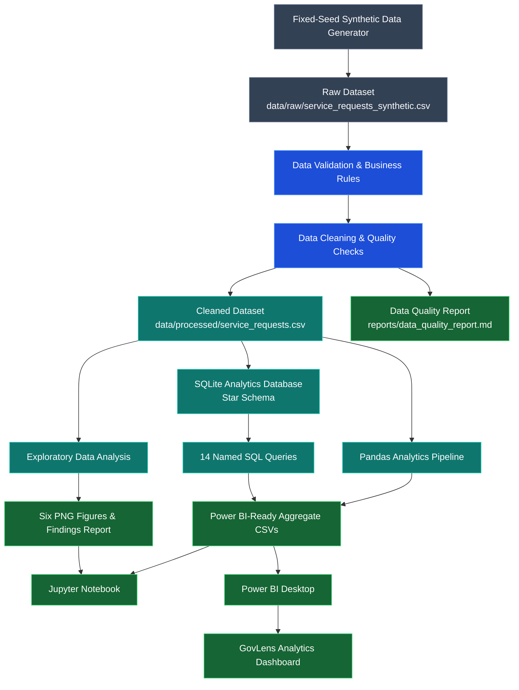

# GovLens — Government Service Delivery Intelligence Platform

GovLens is a reproducible portfolio prototype for exploring service-request
volume, status, completion, backlog, and resolution time. It demonstrates
Python, Pandas, NumPy, SQLite, SQL, visualization, data-quality reporting, and
Power BI handoff practices. It is **not** an official government system and is
not connected to government infrastructure.

> **Data disclosure:** The included records and all computed findings are
> synthetic demonstrations. Sample districts and states are fictional labels;
> no citizen or personal data is included. Never present these results as
> official statistics.

## Business questions and scope

The pipeline explores counts and completion rates by district, category, and
month; pending/in-progress backlog; and completed-case resolution times. The
analysis is descriptive. It does not estimate causal effects or recommend
operational changes based on real-world evidence.

## Architecture



### Component Responsibilities

- **Synthetic Data Generator:** Creates reproducible demonstration records using a fixed random seed. The raw dataset is retained across reruns.
- **Data Validation & Cleaning:** Checks schema, dates, statuses, duplicates, missing values, and business rules before producing the cleaned dataset and quality report.
- **SQLite Analytics Database:** Organizes cleaned records into a star schema for analytical SQL queries.
- **SQL Analytics:** Executes 14 named queries and exports their results for further analysis.
- **Pandas Analytics:** Calculates aggregate metrics and prepares CSV outputs for visualization.
- **Exploratory Data Analysis:** Produces six figures and a written findings report.
- **Jupyter Notebook:** Supports exploratory analysis and interpretation of the results.
- **Power BI Desktop:** Visualizes service volumes, status distribution, monthly trends, category demand, district performance, completion rates, and pending backlogs.

**Data provenance:** GovLens uses synthetic data for demonstration. All records, metrics, and findings are illustrative and do not represent actual government service statistics.
**Data provenance:** GovLens uses a reproducible, fixed-seed synthetic dataset for demonstration. The records and resulting metrics are illustrative and do not represent actual government service data.
## Technology stack

- Python 3.10+ (developed and exercised with Python 3.12.3)
- Pandas, NumPy, SQLite (`sqlite3`), Matplotlib, Seaborn
- pytest for automated tests
- Jupyter Notebook format for exploratory analysis
- Power BI Desktop is an optional manual step; this workspace did not have
  Power BI Desktop available, so no `.pbix` is included.

Dependency ranges are in [requirements.txt](requirements.txt). They are
compatible with the inspected Python 3.12.3 environment.

## Dataset and provenance

An initial public-data lookup was attempted at the Government of India Open
Data portal on **2026-10-16**:
`https://www.data.gov.in/search?title=grievance%20district%20service`. The
request returned HTTP 403 in this environment, so a public dataset could not be
verified or retrieved. The project therefore uses the expressly permitted
synthetic fallback, not a real-world dataset.

The generated file is named `service_requests_synthetic.csv` and is labeled
`source_type = Synthetic`. It contains 6,000 reproducible rows over
2024-01-01–2025-12-31, created with NumPy seed `20261016`. Sample district names
are Aster, Birch, Cedar, Delta, Elm, and Fern; sample state names begin with
“Sample State”. Outcomes vary by district and category, and completed
resolution times use a skewed distribution. Only completed records have
resolution times. No external dataset license applies to these generated
records; the project does not assert a license for the code.

`data/raw/` is not overwritten on pipeline reruns. If the raw file is edited or
replaced, the pipeline will process that file. To regenerate the demonstration
input, remove only `data/raw/service_requests_synthetic.csv` before running the
pipeline again.

## Data dictionary

| Field | Meaning |
|---|---|
| `request_id` | Unique synthetic service-request identifier |
| `submission_date` | Request date, within the configured sample period |
| `district`, `state` | Fictional sample geography labels |
| `service_category` | One of six explicitly allowed sample service categories |
| `department` | Demonstration department mapped from category |
| `status` | Completed, Pending, In Progress, or Rejected |
| `resolution_days` | Non-negative duration for completed requests, otherwise null |
| `source_type` | `Synthetic` |

## Metric definitions

- **Total requests:** all cleaned request rows.
- **Completed/Pending/In Progress/Rejected:** count of rows with the named
  status.
- **Eligible requests:** Completed + Pending + In Progress. Rejected requests
  are explicitly excluded from completion-rate denominators.
- **Completion rate:** Completed / Eligible × 100. If there are no eligible
  requests, the Python result is null; the Power BI measure uses `DIVIDE` with
  a zero alternate result.
- **Unresolved backlog:** Pending + In Progress; rejected cases excluded.
- **Average/median resolution days:** completed requests with a valid,
  non-negative `resolution_days` value only.
- **Month-over-month change:** current month's request count compared with the
  immediately preceding month; the first month has no comparison.

These definitions are consistent in Python, SQL, and the supplied DAX.

## Project layout

```text
config/                  Shared paths, seed, date range, categories, mappings
data/raw/                Generated raw CSV (kept unchanged after creation)
data/processed/          Cleaned CSV, SQLite DB, aggregate/query CSV outputs
notebooks/               Executable analysis notebook
src/                     Generator, loader, cleaning, analytics, database, export
sql/schema.sql           SQLite star schema and indexes
sql/analysis_queries.sql  14 executable analytical queries
reports/                 Computed findings, quality report, and figures
powerbi/                 Dashboard specification, DAX, and import instructions
scripts/run_pipeline.py  One-command end-to-end workflow
tests/                   pytest coverage
```

## Install and reproduce (Windows PowerShell)

From the project root:

```powershell
py -3.12 -m venv .venv
.\.venv\Scripts\Activate.ps1
python -m pip install --upgrade pip
python -m pip install -r requirements.txt
python scripts/run_pipeline.py
```

The generator uses only the installed project dependencies. The pipeline
creates/updates processed outputs, reports, and figures. Rerunning it reuses the
existing raw CSV and rebuilds derived outputs, making the workflow idempotent.
The SQLite database and CSV exports are generated artifacts and are excluded
from Git.

### Notebook

After running the pipeline, open
`notebooks/govlens_analysis.ipynb` in VS Code or Jupyter and run all cells from
the project root. The notebook uses the processed CSV and shared analysis
functions.

### SQL

All 14 named SQL statements in `sql/analysis_queries.sql` execute against
`data/processed/govlens.sqlite`. The pipeline runs each statement and writes a
`sql_<query_name>.csv` result. Example interactive use:

```powershell
python -c "import sqlite3; c=sqlite3.connect('data/processed/govlens.sqlite'); print(c.execute('SELECT COUNT(*) FROM fact_service_request').fetchone()); c.close()"
```

The schema is intentionally small: a fact table references date, district, and
service-category dimensions. Status, source, and resolution duration remain on
the fact table.

### Power BI

**Dashboard status:** Power BI Desktop was not available in the inspected
environment, so a `.pbix` or dashboard screenshots have not been created. The
four-page manual build specification and data model are documented in
[powerbi/dashboard_specification.md](powerbi/dashboard_specification.md).

From the project root, run `python scripts/run_pipeline.py`. In Power BI
Desktop, import `data/processed/service_requests.csv` as the fact,
`data/raw/service_requests_synthetic.csv` as the disconnected raw comparison
table, and `data/processed/data_quality_summary.csv` as the disconnected
missing-values summary. Follow [powerbi/power_query_notes.md](powerbi/power_query_notes.md)
for exact types, transformations, dimensions, relationships, and refresh
checks. Add measures from [powerbi/measures.dax](powerbi/measures.dax), and
build the Executive Overview, District Performance, Service Analysis, and Data
Quality pages per the visual field/format specification.

The completion denominator is Completed + Pending + In Progress; Rejected and
invalid/missing statuses are excluded. A zero eligible denominator displays
blank, matching the Python `None` and SQL `NULL` behavior. Show the synthetic
data disclosure on every report page. The Data Quality validation table is a
verified-run snapshot; refresh its values from the generated report after
rerunning the pipeline. See the dashboard QA checklist for expected card values
and screenshot instructions. Do not represent a `.pbix` as complete until it
has been built and validated in Power BI Desktop.

## Findings and data quality

The pipeline computes actual demonstration results in
[reports/findings.md](reports/findings.md) and
[reports/data_quality_report.md](reports/data_quality_report.md). Findings are
generated from the run's data and must be interpreted as synthetic only. The
data quality report documents raw/cleaned counts, missingness, invalid values,
removals/corrections, and final types. Six charts are saved under
`reports/figures/`.

### Results from the generated demonstration dataset

The verified run contains **6,000** raw and **6,000** cleaned requests. It has
3,874 completed, 958 pending, 738 in progress, and 430 rejected records.
Completion rate is **69.55%** (3,874 / 5,570 eligible); average completed-case
resolution is **8.90 days**, with a **7.00-day** median. Aster has the highest
volume (1,250) and the lowest completion rate (60.7%); Fern has the highest
completion rate (80.0%). Water Supply is the largest category (1,362
requests), while Roads and Infrastructure has the largest pending +
in-progress backlog (408). Volume increased from 246 in November 2025 to 264
in December 2025. These are generated values only, not real-world findings.

## Screenshots

No dashboard screenshots are included because Power BI Desktop was unavailable
and no `.pbix` report was created. After building and validating the report,
capture one legible 16:9 screenshot of each of the four pages, keep the synthetic
data disclosure visible, save the images under `powerbi/screenshots/`, and link
them here. Do not imply the dashboard has been built until a `.pbix` and those
validated screenshots actually exist.

## Testing

```powershell
python -m pytest -q
```

Tests cover reproducible generation, allowed values, data cleaning and
corrections, metric definitions and edge cases, SQL execution, SQLite foreign
keys, and Python/SQL consistency.

## Limitations and future improvements

- No suitable public request-level dataset could be verified from the source
  portal due to its HTTP 403 response here.
- Synthetic records are not evidence of real service demand, district
  performance, operational bottlenecks, or causal relationships.
- District names, category/department mappings, date coverage, and status
  mechanisms are demonstration assumptions.
- A manually authored and validated Power BI `.pbix` remains optional follow-up.
- Future work could replace the generated CSV with a documented, licensed,
  suitably granular public dataset; update the data dictionary and rules to
  reflect its real schema; and validate Power BI interactions with stakeholders.
